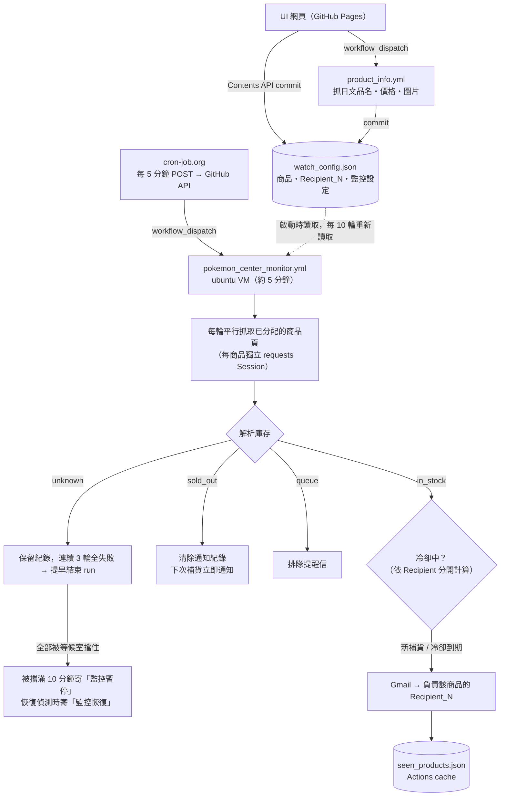

# Pokémon Center Online 補貨偵測器

監控 [ポケモンセンターオンライン](https://www.pokemoncenter-online.com/) 指定商品的庫存，一旦補貨立即透過 Gmail 通知。由 cron-job.org 每 5 分鐘觸發一次 GitHub Actions，每次啟動全新 VM 執行約 5 分鐘的監控（預設 50 輪，每輪間隔 4~6 秒），runner 網路異常最多影響一個 5 分鐘窗口。

監控商品、每個帳號要通知哪些商品、監控參數，都在 **UI 網頁** 上調整：<https://k0341055.github.io/pokemon-center-monitor/>

## UI 網頁（docs/index.html）

| 功能 | 說明 |
|---|---|
| 新增商品 | 貼上官網商品連結或 13 碼商品編號，可一次貼多個；中文名稱可自訂，日文品名、價格、限購、圖片由 GitHub Actions 自動抓取 |
| 分配通知對象 | 把商品卡拖到 Recipient_N 底下（手機用卡片左側的 ⋮⋮ 拖拉），或直接點卡片上的 R1、R2 切換 |
| 移除／移動 | 從某個對象拖回商品庫＝移除；拖到另一個對象＝移動（按住 Option／Alt＝複製） |
| 刪除商品、改中文名稱、重新抓取價格 | 商品卡右側按鈕 |
| 新增／更換／移除收件人 | 「＋ 新增通知對象」輸入信箱；✉ 更換信箱；🗑 移除（同時刪除對應的 Secret）。頁面只顯示代稱 |
| 監控設定 | 監控開關、每次執行輪數、每輪間隔秒數、仍有庫存提醒間隔、排隊提醒開關 |

每次修改都會直接 commit 到 repo 的 [`watch_config.json`](watch_config.json)；正在執行的監控每 10 輪（約 1 分鐘）重新讀取一次設定，不用等下一次 run。

### 通知對象代稱

頁面公開在 GitHub Pages，所以只用代稱 `Recipient_N`、不放信箱。`Recipient_N` 的信箱依序找：

1. GitHub Secret **`RECIPIENT_N`**：在 UI 新增收件人或按 ✉ 更換信箱時寫入
2. GitHub Secret **`GMAIL_RECIPIENTS`** 的第 N 個（逗號分隔，舊設定，仍然有效）

在 UI 輸入的信箱會先在瀏覽器用 repo 的公鑰加密（libsodium sealed box，GitHub 規定的 Secrets 格式），才送給 GitHub API；不會出現在頁面、`watch_config.json`、commit 或瀏覽器儲存空間，存好之後也讀不回來。頁面只會顯示「信箱已設定」或「GMAIL_RECIPIENTS 第 N 個」。

找不到信箱的代稱會在 log 裡警告，它的商品不會通知。

沒有分配給任何人的商品會留在商品庫，但不會去官網檢查。

### 連線 GitHub（第一次使用）

沒有 token 時頁面是唯讀的。在頁面上點「GitHub 連線設定」，貼上 Fine-grained personal access token：

1. GitHub → Settings → Developer settings → [Fine-grained tokens](https://github.com/settings/personal-access-tokens/new) → Generate new token
2. Repository access：**Only select repositories** → `pokemon-center-monitor`
3. Repository permissions：**Contents**、**Actions**、**Secrets** 都設為 **Read and write**（Secrets 只用於新增／更換收件人信箱，沒給也能管理商品）

token 只存在該裝置瀏覽器的 localStorage，只會送給 GitHub API。建議跟 cron-job.org 用的 token 分開建立（cron-job.org 那支只需要 Actions 權限）。

加密用的 [tweetnacl-js](https://github.com/dchest/tweetnacl-js) 1.0.3 放在 `docs/vendor/`（從 npm 取得並核對 integrity），頁面不從 CDN 載入任何程式。

### 監控設定

| 設定 | 預設 | 說明 |
|---|---|---|
| 監控開關 | 開 | 關閉後 cron-job.org 照常觸發，但 run 啟動後直接結束；執行中的 run 會在下次重新讀取設定時提早結束 |
| 每次執行輪數 | 50 | 1～150。超過 job 時限（約 13 分鐘）會自動減少 |
| 每輪間隔秒數 | 4～6 | 2～60，在範圍內隨機 |
| 仍有庫存提醒間隔 | 60 分鐘 | 5～1440 分鐘，同時也是排隊提醒的冷卻時間 |
| 排隊提醒 | 開 | 官網啟用 Queue-it 排隊、或等候室擋住 GitHub 主機時是否寄信 |

觸發頻率（每 5 分鐘）由 cron-job.org 決定，要到 cron-job.org 修改。頁面會依輪數與間隔估算每次執行時間，比 5 分鐘短時會提示有多少空窗。

## 架構



## 偵測邏輯

商品頁為 Salesforce Commerce Cloud 頁面（`Cache-Control: no-cache`，每次請求皆為即時庫存），以 regex 解析：

| 狀態 | 判斷條件 |
|---|---|
| `in_stock` | `<input id="availability" value="true">`、無「品切れ」標籤，且「カートに入れる」按鈕可點選（class 沒有 `default`） |
| `sold_out` | `availability=false`、`<p class="stock"><span>品切れ</span></p>`，或按鈕是灰色不能按（例如受注期間外，頁面不會寫品切れ） |
| `queue` | 停在 Queue-it 排隊頁：官網自己的 `wr.pokemoncenter-online.com` 或 `*.queue-it.net`（大量補貨／新品發售時官網會啟用；沒排隊時等候室會直接導回商品頁） |
| `unknown` | HTTP 錯誤、連線失敗，或頁面缺少 `availability` 標記（可能被 bot 防護攔截或官網改版） |

HTTP 429 / 5xx 與連線逾時最多重試 3 次。

**已知限制：** 官網開啟 Queue-it 等候室（`wr.pokemoncenter-online.com`）期間，GitHub Actions 的主機（Ubuntu x64／ARM、macOS、Windows 都測過）會被擋在「Restricted access」頁（HTTP 403）。這段期間監控看不到任何商品（log 每輪只顯示一行「N 件商品都被擋」，連續 3 輪就提早結束該次 run，run 頁面會出現黃色警告「官網等候室擋住 GitHub 主機」；被擋滿 10 分鐘會寄「監控暫停」信），UI 新增的商品也抓不到品名與價格；等候室關閉後自動恢復，新增的商品再按 ↻ 重新抓取即可。

等候室開著時，UI「新增商品」下方的 **匯入監控** 書籤可以代替 GitHub 抓商品資訊：把按鈕拖到書籤列，在官網商品頁點一下，就會用你自己的瀏覽器讀取該頁的日文品名、價格、限購、圖片和庫存，回到 UI 確認後寫進 `watch_config.json`（商品不在商品庫就新增）。只補商品資訊，監控本身仍要等等候室關閉。

## 通知邏輯

每位 Recipient 分開寄信、分開計算冷卻，信件只列出該對象負責的商品。

| 情境 | 行為 |
|---|---|
| 商品從售完變成有庫存 | **立即**寄「補貨了！」給負責的對象 |
| 商品持續有庫存 | 每隔「仍有庫存提醒間隔」提醒一次（標題「仍有庫存」） |
| 商品確認售完 | 清除所有人的通知紀錄，下次補貨重新立即通知 |
| 商品新分配給某人（且正有庫存） | 該對象立即收到通知 |
| `unknown` / `queue` | 保留通知紀錄（避免暫時性錯誤造成重複通知） |
| 官網啟用排隊 | 寄「排隊中」提醒（套用同一冷卻時間，可在 UI 關閉），請手動進入排隊確認 |
| 官網等候室擋住 GitHub 主機 | 連續被擋滿 10 分鐘寄一次「監控暫停」（列出該對象的商品，請自己到官網確認），之後第一次正常偵測時寄「監控恢復」；與排隊提醒共用 UI 開關 |

Email 發送失敗時不寫入冷卻紀錄，下一輪會重試。

## 環境設定

### GitHub Secrets（必填）

| Secret | 說明 |
|---|---|
| `GMAIL_SENDER` | 寄件 Gmail 帳號 |
| `GMAIL_PASSWORD` | Gmail App Password（非登入密碼） |
| `RECIPIENT_N` | `Recipient_N` 的信箱，由 UI 新增收件人時寫入（不用手動建立），N 最大 10 |
| `GMAIL_RECIPIENTS` | 舊設定：收件人逗號分隔，第 N 個＝`Recipient_N`（沒有 `RECIPIENT_N` 時使用）。全部收件人都改用 UI 設定後可刪除 |

> 設定路徑：GitHub Repo → Settings → Secrets and variables → Actions → **Secrets** 標籤 → New repository secret

### 觸發方式

在 **cron-job.org** 建立每 5 分鐘一次的任務：

```
POST https://api.github.com/repos/k0341055/pokemon-center-monitor/actions/workflows/pokemon_center_monitor.yml/dispatches
```

Request Headers：
```
Authorization: Bearer <PAT>
Content-Type: application/json
Accept: application/vnd.github+json
```

Request Body：
```json
{"ref": "main"}
```

成功回應：**204 No Content**

> PAT 需要此 repo 的 **Actions: Read and write** 權限（Fine-grained token）。workflow 設有 `concurrency`，上一個 run 未結束時新的 run 會排隊等待，不會同時執行。

### Workflows

| Workflow | 觸發 | 說明 |
|---|---|---|
| `pokemon_center_monitor.yml` | cron-job.org | 監控本體。手動執行時可填 `check_rounds`（覆寫 UI 輪數）、`test_mode`、`send_test_email` |
| `product_info.yml` | UI 新增商品／按「重新抓取」 | 抓商品頁資訊寫回 `watch_config.json`。手動執行時 `ids` 留空＝補齊缺資料的商品，`refresh_all` 填 `1`＝全部重新抓取 |

`send_test_email` 會對每個有設定的信箱各寄一封測試信，信中列出它對應的 `Recipient_N`、信箱來源（`RECIPIENT_N` 或 `GMAIL_RECIPIENTS` 第 N 個）與會通知的商品，可用來確認代稱對應正確。

### 選填環境變數

| 變數 | 預設 | 說明 |
|---|---|---|
| `CHECK_ROUNDS` | 空（用 UI 設定） | 有填時覆寫每次 run 的偵測輪數 |
| `TEST_MODE` | 空 | 非空時信件標題加上【測試】 |
| `SEND_TEST_EMAIL` | 空 | 非空時只寄測試信確認 Gmail 設定，不執行偵測 |
| `RECIPIENT_N` | 空 | `Recipient_N` 的信箱。workflow 逐一傳入 Secret `RECIPIENT_1`～`RECIPIENT_10`（所以 UI 最多 10 位通知對象）；不用 `toJSON(secrets)` 整包傳入，那樣 GitHub 會判定 workflow 可疑而要求每次手動核准 |
| `CONFIG_FILE` | `watch_config.json` | 監控設定檔 |
| `CONFIG_RELOAD_ROUNDS` | `10` | 執行中每隔幾輪從 GitHub 重新讀取設定（需要 `GITHUB_TOKEN`，Actions 中自動提供） |
| `STATE_FILE` | `seen_products.json` | 通知冷卻狀態檔 |

## 本機執行

```bash
cp .env.example .env   # 填入 Gmail 帳密與收件人
pip install -r requirements.txt
CHECK_ROUNDS=1 python pokemon_center_monitor.py
python product_info.py --all   # 重新抓取所有商品資訊
```

## 狀態持久化

通知冷卻紀錄存於 `seen_products.json`（`{"notified": {"Recipient_N": {商品id: 通知時間}}}`），透過 Actions cache 跨 run 保存（key 為 `pokemon-seen-<run_id>`，以 `pokemon-seen-` 前綴還原最新一份）。Actions cache 最長保留 7 天，cache miss 時視為全新狀態，有庫存商品會立即通知一次。從某人清單移除的商品，其紀錄會一併清掉。
