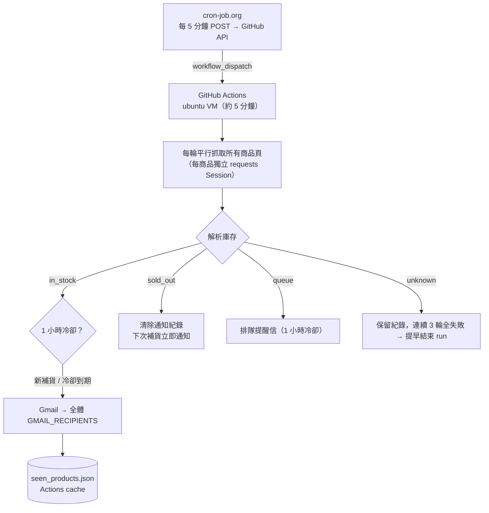

# Pokémon Center Online 補貨偵測器

監控 [ポケモンセンターオンライン](https://www.pokemoncenter-online.com/) 指定商品的庫存，一旦補貨立即透過 Gmail 通知。由 cron-job.org 每 5 分鐘觸發一次 GitHub Actions，每次啟動全新 VM 執行約 5 分鐘的監控（約 50 輪，每輪間隔 4~6 秒），runner 網路異常最多影響一個 5 分鐘窗口。

## 監控商品

| 商品 | 商品頁 |
|---|---|
| 🎄 聖誕樹皮卡丘娃娃 | [もちふわぬいぐるみ クリスマスじゅんびチュウ！ ツリーごっこピカチュウ](https://www.pokemoncenter-online.com/4521329454221.html) |
| 🍪 偷吃餅乾皮卡丘吊飾 | [マスコット クリスマスじゅんびチュウ！ ピカチュウ つまみぐい](https://www.pokemoncenter-online.com/4521329454238.html) |
| 🧸 皮卡丘與多邊獸Ⅱ玩具吊飾 | [マスコット クリスマスじゅんびチュウ！ ピカチュウとポリゴン2のおもちゃ](https://www.pokemoncenter-online.com/4521329454252.html) |
| 🎁 聖誕準備啾！蓬鬆玩偶 BOX | [ふわふわドール クリスマスじゅんびチュウ！BOX](https://www.pokemoncenter-online.com/4521329454306.html) |
| 😴 Pokémon Sleep 晚安咚咚鼠娃娃 | [もっちりぬいぐるみ Pokémon Sleep おやすみデデンネ](https://www.pokemoncenter-online.com/4521329425672.html) |
| 🚪 咚咚鼠等身大門擋（2.2kg） | [ずっしり2.2kg！等身大ドアストッパー でんきちょーだい！ デデンネ](https://www.pokemoncenter-online.com/4521329419589.html) |
| 🧲 咚咚鼠・電電蟲磁鐵掛勾 | [マグネットフック でんきちょーだい！ デデンネ・バチュル](https://www.pokemoncenter-online.com/4521329434230.html) |
| 🤍 淺淺丘娃娃（Pokopia 淺色皮卡丘） | [ぬいぐるみ ぽこ あ ポケモン ピカチュウ（うすいろ）](https://www.pokemoncenter-online.com/4521329436845.html) |
| 🤍 淺淺丘登山扣吊飾 | [カラビナ付きマスコット ぽこ あ ポケモン ピカチュウ（うすいろ）](https://www.pokemoncenter-online.com/4521329454535.html) |
| 🟣 百變怪變身皮卡丘吊飾 | [マスコット へんしん！メタモン ピカチュウ](https://www.pokemoncenter-online.com/4521329453422.html) |
| 😨 十ポケ十色 膽小皮卡丘吊飾 | [マスコット 十ポケ十色 おくびょうなピカチュウ](https://www.pokemoncenter-online.com/4521329397658.html) |

新增／移除商品：編輯 `pokemon_center_monitor.py` 的 `WATCH_PRODUCTS`（`id` 為商品頁網址中的 13 碼數字）。

## 架構



## 偵測邏輯

商品頁為 Salesforce Commerce Cloud 頁面（`Cache-Control: no-cache`，每次請求皆為即時庫存），以 regex 解析：

| 狀態 | 判斷條件 |
|---|---|
| `in_stock` | `<input id="availability" value="true">` 且無「品切れ」標籤 |
| `sold_out` | `availability=false` 或 `<p class="stock"><span>品切れ</span></p>` |
| `queue` | 被導向 `*.queue-it.net` 排隊頁（大量補貨／新品發售時官網會啟用） |
| `unknown` | HTTP 錯誤、連線失敗，或頁面缺少 `availability` 標記（可能被 bot 防護攔截或官網改版） |

HTTP 429 / 5xx 與連線逾時最多重試 3 次。

## 通知邏輯

| 情境 | 行為 |
|---|---|
| 商品從售完變成有庫存 | **立即**發送「補貨了！」通知 |
| 商品持續有庫存 | 每 1 小時提醒一次（標題「仍有庫存」） |
| 商品確認售完 | 清除通知紀錄，下次補貨重新立即通知 |
| `unknown` / `queue` | 保留通知紀錄（避免暫時性錯誤造成重複通知） |
| 官網啟用排隊 | 發送「排隊中」提醒（1 小時冷卻），請手動進入排隊確認 |

Email 發送失敗時不寫入冷卻紀錄，下一輪會重試。

## 環境設定

### GitHub Secrets（必填）

| Secret | 說明 |
|---|---|
| `GMAIL_SENDER` | 寄件 Gmail 帳號 |
| `GMAIL_PASSWORD` | Gmail App Password（非登入密碼） |
| `GMAIL_RECIPIENTS` | 收件人，逗號分隔 |

> 設定路徑：GitHub Repo → Settings → Secrets and variables → Actions → **Secrets** 標籤 → New repository secret

### 觸發方式

在 **cron-job.org** 建立每 5 分鐘一次的任務：

```
POST https://api.github.com/repos/k0341055/pokemon-center-monitor/actions/workflows/pokemon_center_monitor.yml/dispatches
```

Request Headers：
```
Authorization: Bearer <PAT>
Content-Type: application/json
Accept: application/vnd.github+json
```

Request Body：
```json
{"ref": "main"}
```

成功回應：**204 No Content**

> PAT 需要此 repo 的 **Actions: Read and write** 權限（Fine-grained token）。workflow 設有 `concurrency`，上一個 run 未結束時新的 run 會排隊等待，不會同時執行。

### 選填環境變數

| 變數 | 預設 | 說明 |
|---|---|---|
| `CHECK_ROUNDS` | `1`（workflow 預設 `50`） | 每次 run 的偵測輪數 |
| `TEST_MODE` | 空 | 非空時信件標題加上【測試】 |
| `SEND_TEST_EMAIL` | 空 | 非空時只寄一封測試信確認 Gmail 設定，不執行偵測（Actions 手動執行時 `send_test_email` 填 `1`） |
| `STATE_FILE` | `seen_products.json` | 通知冷卻狀態檔 |

## 本機執行

```bash
cp .env.example .env   # 填入 Gmail 帳密與收件人
pip install -r requirements.txt
CHECK_ROUNDS=1 python pokemon_center_monitor.py
```

## 狀態持久化

通知冷卻紀錄存於 `seen_products.json`（`{"notified": {商品id: 通知時間}}`），透過 Actions cache 跨 run 保存（key 為 `pokemon-seen-<run_id>`，以 `pokemon-seen-` 前綴還原最新一份）。Actions cache 最長保留 7 天，cache miss 時視為全新狀態，有庫存商品會立即通知一次。
